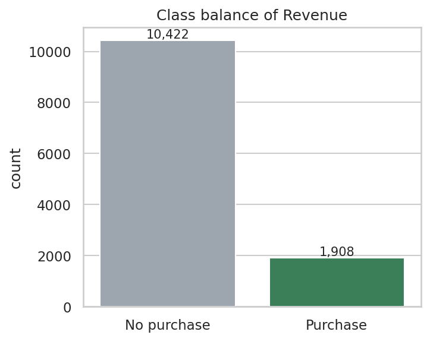

# Online Shoppers Purchasing Intention: Classification Report

Auto-generated by `shopper_intent_master.py`. Dataset: [UCI Online Shoppers Purchasing Intention](https://archive.ics.uci.edu/dataset/468/online+shoppers+purchasing+intention+dataset).

## Setup

- Sessions after removing 125 duplicates: 12,205
- Train/test split: 9,764 / 2,441 (stratified, test size 20%, seed 42)
- Buyer share: 15.6% (train), 15.6% (test)
- Models: Logistic Regression, Random Forest, XGBoost, and a stacking ensemble
- Imbalance handling: class weights; encoders and scalers fitted on the training set only

## Results (test set, positive class = purchase)

| Model | Accuracy | Precision | Recall | F1 | ROC-AUC |
|---|---|---|---|---|---|
| Logistic Regression | 0.8710 | 0.5601 | 0.8168 | 0.6645 | 0.9256 |
| Random Forest | 0.8976 | 0.6755 | 0.6649 | 0.6702 | 0.9287 |
| XGBoost | 0.8710 | 0.5585 | 0.8377 | 0.6702 | 0.9364 |
| Stacking Ensemble | 0.8640 | 0.5422 | 0.8403 | 0.6591 | 0.9354 |

Best model by F1: **Random Forest** (0.6702).

## Business findings
- Overall conversion rate: 15.6% of 12,205 unique sessions.
- Best month: Nov (25.5%); weakest month: Feb (1.7%). Note that Feb may have few sessions, so check the counts above.
- New_Visitor: 24.9% conversion across 1,693 sessions.
- Other: 19.8% conversion across 81 sessions.
- Returning_Visitor: 14.1% conversion across 10,431 sessions.
- Mean PageValues: 27.3 for buyers vs 2.0 for non-buyers; it is the strongest behavioural signal of purchase intent.
- BounceRates and ExitRates correlate at 0.90; ProductRelated and ProductRelated_Duration at 0.86 (redundant, which matters for linear models).

## Algorithm justification
Dataset facts: 12,205 sessions, 73 features after encoding, only 15.6% buyers, heavy right skew (e.g. PageValues skew 6.4 -> 1.8 after log1p), correlated pairs (BounceRates/ExitRates r=0.90), and a mix of numeric and categorical columns.

- **Logistic Regression** (baseline): suits a binary target, gives interpretable coefficients that a business client can read, and is fast. It needs scaling and log-transformed inputs and is sensitive to correlated features, so it shows what the preprocessing buys. `class_weight='balanced'` counters the imbalance.
- **Random Forest**: handles mixed feature types, skew and non-linear interactions (for example month x visitor type) without transforms. Bagging reduces variance, it is robust to correlated and noisy features, and it provides feature importance. `class_weight='balanced_subsample'` handles imbalance.
- **XGBoost** (gradient boosting): usually the strongest model on tabular data. It builds trees sequentially to correct earlier errors, which captures subtle patterns in the minority class, and it supports imbalance directly (`scale_pos_weight`).
- **Stacking**: the three models have different inductive biases (linear, bagged trees, boosted trees), so their errors are not identical. A logistic-regression meta-learner trained on out-of-fold probabilities learns how much to trust each one.
- **Metrics**: with ~85/15 classes, accuracy alone is misleading (predicting 'no purchase' always scores ~85%). Recall shows how many buyers are found, precision how many flagged sessions really buy, F1 balances them, and ROC-AUC measures ranking quality independent of the threshold.

## Ensemble result
- Best single model by F1: Random Forest (0.6702); by ROC-AUC: XGBoost (0.9364).
- Stacking: F1 0.6591 (-0.0110), ROC-AUC 0.9354 (-0.0010) versus the best single model on each metric.
- Versus Random Forest: precision -0.1333, recall +0.1754.
- **Interpretation:** Stacking gave no meaningful gain over the best single model. That is a legitimate result: the gradient boosting model already captures most of the signal, and the base learners' errors overlap heavily.
- **Why gains are usually small here:** most predictive power sits in a few features (PageValues, ExitRates, month), which all models exploit, so their errors are highly correlated. Stacking helps most when base models disagree in useful ways. The balanced meta-learner also moves the decision threshold, which can trade precision for recall.
- **Caveat:** one 80/20 split on ~12k rows is a noisy estimate. Differences of a few thousandths are within noise; repeated cross-validation would be needed to claim a win.

## Figures

### Class balance

### Conversion rate by month

### Conversion rate by visitor type

### Visitor type x month

### PageValues by outcome

### Raw skewed distributions

### Correlation heatmap

### Distributions after log transform

### Confusion matrices

### ROC curves

### Model comparison

### Feature importance

